# Customer-Behavior-Analysis-

Performed customer behavior analysis using Python (data cleaning & processing), SQL (data analysis), and Power BI (data visualization) to identify purchasing trends, customer segments, and category-wise revenue insights.
